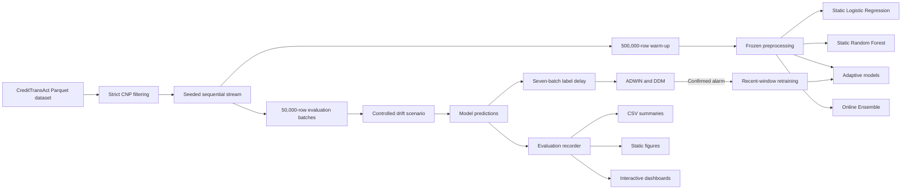
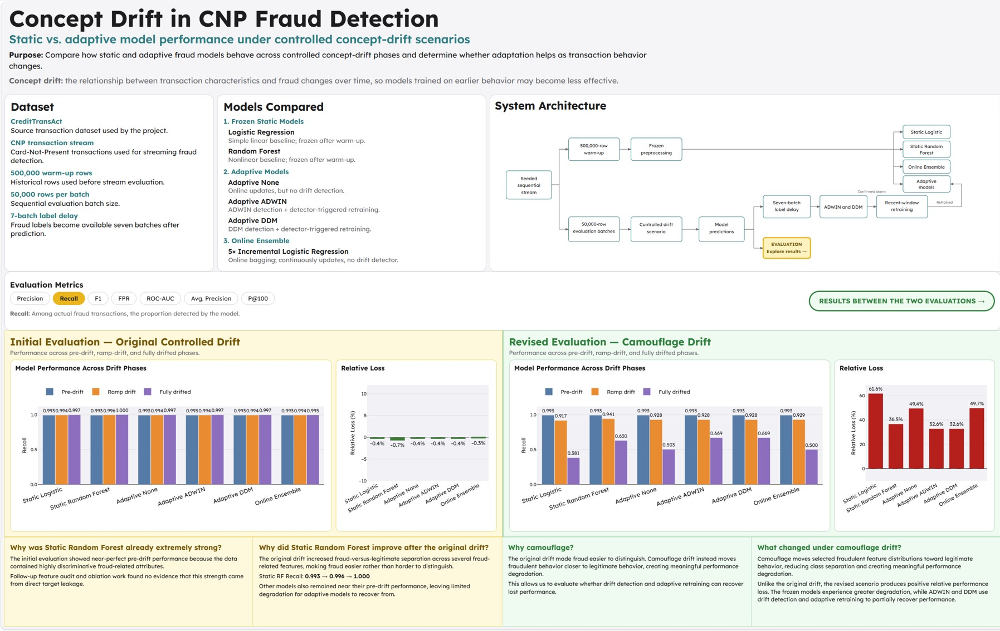
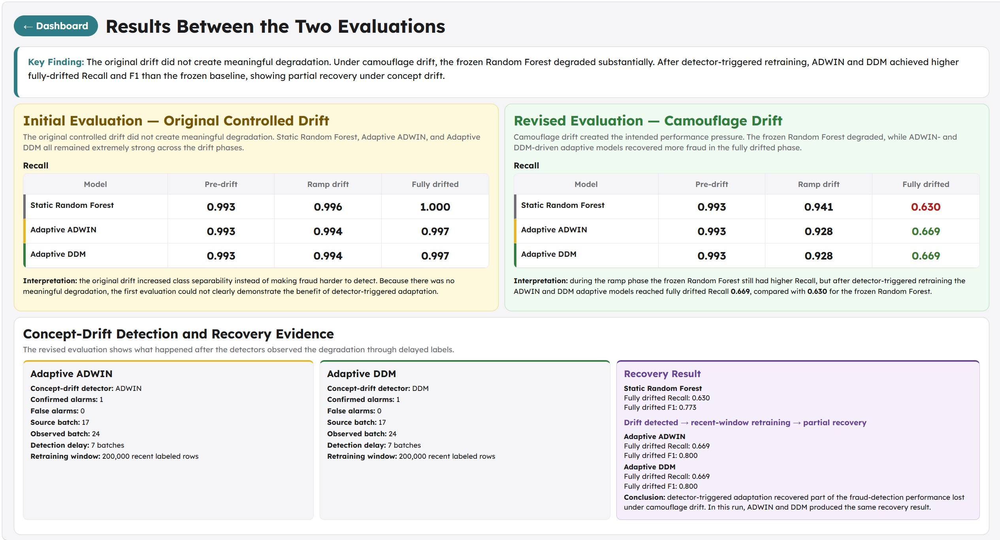

# SentinelFlow: Adaptive Real-Time CNP Fraud Detection under Concept Drift

SentinelFlow is an experimental machine-learning system for studying how credit-card fraud models behave when transaction patterns change over time.

The project simulates a stream of Card-Not-Present (CNP) transactions, compares frozen static models with adaptive online models, detects concept drift using ADWIN and DDM, retrains adaptive models using recently released labels, and produces reproducible evaluation artifacts and interactive dashboards.

> **Project status:** Implementation and experimental evaluation are complete.
> **Scope:** Academic research prototype—not a production fraud-blocking system.

---

## Research Question

Can drift-aware adaptive learning preserve fraud-detection performance better than frozen static models when transaction behavior changes?

The final experiments show that it can—when the drift actually degrades the original decision boundary.

Under the harmful **camouflage drift** scenario, the frozen models lose substantial fraud recall, while ADWIN-triggered recovery restores most of that performance.

---

## Main Findings

The main study used:

- 500,000 warm-up transactions
- 3,343,653 evaluation transactions
- 67 evaluation batches
- 50,000 transactions per full batch
- A seven-batch label delay
- Seeds 543, 544, and 545
- Three scenarios: no drift, separability drift, and camouflage drift
- Six static and adaptive model configurations

### Camouflage-drift performance

Mean fully drifted-phase performance over seeds 543, 544, and 545:

| Model | Precision | Recall | F1 | FPR | ROC-AUC | Average Precision |
| --- | ---: | ---: | ---: | ---: | ---: | ---: |
| Static Logistic Regression | 0.994 | 0.478 | 0.642 | 0.001 | 0.982 | 0.939 |
| Static Random Forest | 0.999 | 0.608 | 0.755 | <0.001 | 0.993 | 0.977 |
| Adaptive without detector | 0.995 | 0.616 | 0.760 | 0.001 | 0.989 | 0.965 |
| **Adaptive with ADWIN** | **0.989** | **0.921** | **0.953** | 0.002 | **0.994** | **0.987** |
| Adaptive with DDM | 0.987 | 0.906 | 0.944 | 0.002 | 0.994 | 0.985 |
| Online Ensemble | 0.996 | 0.607 | 0.754 | <0.001 | 0.989 | 0.964 |

### Detector findings

- ADWIN detected camouflage drift in all three seeds.
- ADWIN produced no false alarms in the no-drift runs.
- ADWIN detected the harmful change 7–9 source batches after drift began.
- With the seven-batch label delay included, alarms were observed after 14–16 batches.
- DDM also detected camouflage drift, but it was less stable and generated false alarms in one seed.
- All nine study runs completed with zero recovery-contract violations.

### Interpretation

The original separability drift made fraud easier to distinguish and therefore did not demonstrate the value of adaptation. That result was investigated rather than hidden.

The added camouflage scenario moves fraudulent transactions toward legitimate-looking behavior. It creates measurable performance degradation and shows the intended result:

> A frozen model can lose fraud recall under harmful drift, while drift detection followed by recent-window retraining can restore performance.

ADWIN was the most reliable detector in the final study.

---

## System Architecture



---

## Implemented Capabilities

SentinelFlow includes:

- Audited Parquet dataset loading
- Strict Card-Not-Present transaction filtering
- Memory-bounded row-group processing
- Seeded and reproducible stream construction
- Warm-up and evaluation-stream separation
- Frozen feature preprocessing
- Identifier and target leakage protection
- Static Logistic Regression and Random Forest baselines
- Incremental adaptive models
- ADWIN and DDM concept-drift detectors
- Recent-window model recovery after confirmed alarms
- Online ensemble comparison
- Delayed-label simulation
- No-drift, separability-drift, and camouflage-drift scenarios
- Batch-, phase-, and overall evaluation
- Detector false-alarm, missed-detection, and delay analysis
- Feature-signal audit and ablation experiments
- CSV, JSON, PNG, and interactive HTML artifacts
- Automated tests and CI validation

---

## Dataset

The implemented project uses the public **CreditTransAct** dataset from Mendeley Data:

[CreditTransAct dataset, version 1](https://data.mendeley.com/datasets/y64bbnm2s3/1)

Download:

```text
credit_card_fraud.parquet
```

Place the unchanged file at:

```text
data/raw/credit_card_fraud.parquet
```

Verified dataset properties:

| Property | Value |
| --- | ---: |
| Source rows | 15,000,000 |
| Strict-CNP rows | 3,843,653 |
| Strict-CNP fraud rows | 564,272 |
| Strict-CNP fraud rate | 14.6806% |
| File size | Approximately 487 MB |
| Warm-up rows | 500,000 |
| Full evaluation rows | 3,343,653 |

Verified SHA-256:

```text
4a33623216213beb121cdc85006cf36f336601af7645e73feabe1abdf94e0823
```

The raw dataset is intentionally excluded from Git. Never commit the Parquet file.

The original project proposal mentioned the ULB/Kaggle dataset. The implemented study uses CreditTransAct instead, so this dataset change must be stated in the final report.

Detailed dataset instructions are available in [`docs/DATASET.md`](docs/DATASET.md).

---

## Models

### Frozen static baselines

- Logistic Regression
- Random Forest

These models are trained during warm-up and remain frozen during the evaluation stream.

### Adaptive configurations

- `adaptive_none`: incremental learner without a drift detector
- `adaptive_adwin`: incremental learner with ADWIN-triggered recovery
- `adaptive_ddm`: incremental learner with DDM-triggered recovery
- `online_ensemble`: online bagging-style ensemble

When a confirmed detector alarm occurs, the corresponding adaptive model is reset and retrained using up to 200,000 recently released labeled rows.

---

## Drift Scenarios

SentinelFlow supports three controlled scenarios.

### `none`

No controlled drift is injected. This is the false-alarm control.

### `separability`

Fraudulent transactions are shifted away from legitimate behavior.

On CreditTransAct, this makes fraud easier to detect. Model performance improves, so recovery is not required.

### `camouflage`

Fraudulent numeric and categorical features are moved toward legitimate-looking behavior.

Labels, legitimate rows, and row counts are not changed. This scenario degrades the original decision boundary and is the primary scenario used to demonstrate adaptive recovery.

See [`docs/DRIFT_SCENARIOS.md`](docs/DRIFT_SCENARIOS.md) for the full scenario definitions.

---

## Evaluation Metrics

The system reports:

- Precision
- Recall
- F1 score
- False-positive rate
- ROC-AUC
- Average Precision
- Precision@100
- Relative Performance Loss

Metrics are calculated at:

- Batch level
- Drift-phase level
- Whole-run level

Detector evaluation includes:

- Confirmed alarms
- Suppressed alarms
- False alarms
- Missed detections
- Source-batch detection delay
- Observed detection delay
- Recovery-contract violations

Accuracy is not used as the primary metric because fraud detection is an imbalanced classification problem.

---

## Requirements

- Python 3.11, 3.12, or 3.13
- Approximately 500 MB of storage for the dataset
- Additional storage for generated experiment artifacts

Major dependencies include:

- NumPy
- pandas
- PyArrow
- SciPy
- scikit-learn
- River
- Matplotlib
- Plotly
- PyYAML
- pytest
- Ruff

---

## Installation

Clone the repository:

```bash
git clone https://github.com/Sanjaysoralamavu/sentinelflow-fraud-detection.git
cd sentinelflow-fraud-detection
```

Create and activate a virtual environment:

```bash
python3 -m venv .venv
source .venv/bin/activate
```

On Windows PowerShell:

```powershell
python -m venv .venv
.venv\Scripts\Activate.ps1
```

Install the project and development dependencies:

```bash
python -m pip install --upgrade pip
python -m pip install -e ".[dev]"
```

Alternatively, on macOS or Linux:

```bash
make install
```

---

## Dataset Setup

Create the local data directories:

```bash
mkdir -p data/raw data/processed
```

Copy the downloaded dataset:

```bash
cp /path/to/credit_card_fraud.parquet data/raw/credit_card_fraud.parquet
```

Verify the file:

```bash
ls -lh data/raw/credit_card_fraud.parquet
shasum -a 256 data/raw/credit_card_fraud.parquet
```

Run the dataset audit:

```bash
python -m sentinelflow.data.audit \
  --config configs/full.yaml
```

Expected acceptance checks:

- Binary target with no null labels
- 15,000,000 source rows
- 3,843,653 strict-CNP rows
- 564,272 strict-CNP fraud rows
- Matching SHA-256 checksum

Audit artifacts are written to:

```text
results/metrics/audit/
```

---

## Validate the Configuration

```bash
sentinelflow show-config --config configs/full.yaml
```

Or:

```bash
make show-config
```

---

## Run a Smoke Experiment

A smoke run processes the normal 500,000-row warm-up followed by a limited evaluation stream:

```bash
sentinelflow run \
  --config configs/full.yaml \
  --max-evaluation-rows 100000
```

To save the concise JSON response:

```bash
sentinelflow run \
  --config configs/full.yaml \
  --max-evaluation-rows 100000 \
  > /tmp/sentinelflow-smoke.json

python -m json.tool /tmp/sentinelflow-smoke.json
```

---

## Run the Full Single Experiment

```bash
sentinelflow run --config configs/full.yaml
```

This processes:

- 500,000 warm-up rows
- The complete 3,343,653-row evaluation stream
- All six model configurations
- The configured drift behavior
- Delayed labels and detector updates
- Experiment and evaluation artifact generation

The command prints a concise JSON summary containing:

- Row and batch counts
- Drift phases
- Model names
- Detector events
- Runtime
- Artifact locations

---

## Reproduce the Final Multi-Seed Study

Run the complete study over all three scenarios and seeds:

```bash
python scripts/run_detector_study.py \
  --seeds 543 544 545 \
  --evaluation-outputs
```

This runs nine complete experiments:

| Scenario | Seeds |
| --- | --- |
| No drift | 543, 544, 545 |
| Separability | 543, 544, 545 |
| Camouflage | 543, 544, 545 |

The complete study can take several minutes depending on the computer.

For a shorter detector-study smoke run:

```bash
python scripts/run_detector_study.py \
  --seeds 543 \
  --max-evaluation-rows 500000 \
  --evaluation-outputs
```

Study artifacts are written to:

```text
results/metrics/experiment/detector_study/
```

The two main aggregate files are:

```text
results/metrics/experiment/detector_study/detector_summary.csv
results/metrics/experiment/detector_study/model_phase_summary.csv
```

---

## Open the Interactive Dashboard

## Open the Interactive Dashboard

The final comparison dashboard evaluates concept drift in Card-Not-Present (CNP) fraud detection by comparing two controlled drift scenarios:

- **Initial Evaluation — Original Controlled Drift:** the original drift increased fraud-versus-legitimate separation and produced little meaningful performance degradation.
- **Revised Evaluation — Camouflage Drift:** fraudulent behavior is moved closer to legitimate behavior, creating a more challenging drift condition for evaluating adaptive recovery.

## Concept Drift Evaluation Dashboard

The dashboard compares frozen static models, adaptive models using ADWIN and DDM drift detection, and an online ensemble across pre-drift, ramp-drift, and fully drifted phases.

### Dashboard Overview



### Evaluation Comparison



### Interactive Dashboard

**[View the dashboard HTML](results/experiment_comparison/index.html)**

To use the interactive dashboard, clone or download the repository and open:

```powershell
Start-Process results\experiment_comparison\index.html
```

Available evaluation metrics include:

- Precision
- Recall
- F1
- False Positive Rate (FPR)
- ROC-AUC
- Average Precision
- Precision@100

The dashboard also provides:

- Model performance across the three drift phases
- Relative performance loss from pre-drift to fully drifted
- Explanations of the initial and revised drift scenarios
- A direct comparison of Static Random Forest, Adaptive ADWIN, and Adaptive DDM
- Concept-drift detection and recovery evidence
- Detector alarms, false alarms, detection delay, and retraining information

### Open the Dashboard Locally

On macOS:

```bash
open results/experiment_comparison/index.html
```

On Linux:

```bash
xdg-open results/experiment_comparison/index.html
```

On Windows PowerShell:

```powershell
Start-Process results\experiment_comparison\index.html
```

The dashboard uses results from the original controlled-drift and revised camouflage-drift evaluations.

---

## Generated Artifacts

A standard experiment produces:

### Reproducibility artifacts

```text
run_manifest.json
feature_manifest.json
drift_events.json
```

### Evaluation tables

```text
batch_metrics.csv
phase_summary.csv
model_summary.csv
detector_quality.csv
relative_performance_loss.csv
```

### Static visualizations

```text
model_comparison.png
f1_timeline.png
precision_timeline.png
recall_timeline.png
fpr_timeline.png
roc_auc_timeline.png
average_precision_timeline.png
precision_at_100_timeline.png
relative_performance_loss.png
```

### Interactive dashboards

```text
dashboard/index.html
dashboard/precision.html
dashboard/recall.html
dashboard/fpr.html
dashboard/roc_auc.html
dashboard/average_precision.html
```

Generated artifacts are excluded from Git because complete multi-run outputs can be large.

---

## Feature Audit and Ablation Study

CreditTransAct contains several highly discriminative synthetic features. Some categorical values correspond almost exclusively to fraud, which explains the near-ceiling no-drift performance.

The feature audit found no direct target or identifier leakage in the model input. However, high predictive signal is distributed across multiple synthetic generator features.

Three feature configurations are available:

| Configuration | Purpose |
| --- | --- |
| `configs/full.yaml` | Complete audited feature set |
| `configs/ablation_reduced.yaml` | Removes the strongest flagged features and numeric sources |
| `configs/ablation_strict.yaml` | Removes the reduced set plus additional near-deterministic features |

Run the ablations with:

```bash
sentinelflow run --config configs/ablation_reduced.yaml
sentinelflow run --config configs/ablation_strict.yaml
```

See [`docs/FEATURE_AUDIT.md`](docs/FEATURE_AUDIT.md) for the evidence and interpretation.

---

## Scenario Diagnostics

To compare no drift, separability, and camouflage using frozen static baselines:

```bash
python -m sentinelflow.streaming.scenario_report \
  --config configs/full.yaml \
  --max-evaluation-rows 600000
```

Additional diagnostic scripts are available:

```bash
python scripts/diagnose_categorical_signal.py
python scripts/diagnose_drift_separation.py
```

---

## Testing and Quality Checks

Run the complete quality suite:

```bash
make lint
make test
```

Equivalent commands:

```bash
python -m ruff check .
python -m ruff format --check .
python -m pytest
```

At the final project integration point:

```text
Ruff lint:       passed
Ruff formatting: passed
Automated tests: 250 passed
Git status:      clean
```

The automated tests cover:

- Configuration validation
- Dataset loading and auditing
- Preprocessing and leakage protection
- Static and adaptive models
- Stream construction
- Delayed labels
- Drift scenarios
- ADWIN and DDM behavior
- Recovery logic
- Evaluation metrics
- Artifact export
- Interactive dashboards
- Feature ablations
- Multi-seed detector studies
- CLI integration

---

## Repository Structure

```text
sentinelflow-fraud-detection/
├── configs/
│   ├── full.yaml
│   ├── no_drift_smoke.yaml
│   ├── ablation_reduced.yaml
│   └── ablation_strict.yaml
├── data/
│   ├── raw/                         # Local dataset; ignored by Git
│   └── processed/
├── docs/
│   ├── DATASET.md
│   ├── DRIFT_SCENARIOS.md
│   ├── FEATURE_AUDIT.md
│   └── detector_study.md
├── results/                         # Audits and generated experiment outputs
├── scripts/
│   ├── diagnose_categorical_signal.py
│   ├── diagnose_drift_separation.py
│   └── run_detector_study.py
├── src/sentinelflow/
│   ├── data/                        # Audit, loading, and preprocessing
│   ├── evaluation/                  # Metrics, recording, export, and dashboards
│   ├── models/                      # Static and adaptive models
│   ├── streaming/                   # Stream, drift, diagnostics, and scenarios
│   ├── cli.py
│   ├── config.py
│   ├── dashboard.py
│   ├── experiment.py
│   └── suite.py
├── tests/
├── Makefile
├── pyproject.toml
└── README.md
```

---

## Proposal Alignment

| Proposed capability | Final implementation |
| --- | --- |
| Stream credit-card transactions in batches | Implemented |
| Compare static and adaptive models | Implemented |
| Logistic Regression and Random Forest baselines | Implemented |
| Incremental adaptive learning | Implemented |
| ADWIN and DDM drift detection | Implemented |
| Adapt after significant drift | Implemented using recent-window retraining |
| Simulate delayed fraud labels | Implemented with seven-batch delay |
| Controlled-drift experiment | Implemented |
| No-drift comparison | Implemented |
| Precision, Recall, F1, ROC-AUC, and FPR | Implemented |
| Rolling performance plots | Implemented |
| Interactive demonstration dashboard | Implemented |
| Reproducible experimental artifacts | Implemented |
| Production banking deployment | Intentionally out of scope |

The central proposal objective has therefore been achieved: SentinelFlow demonstrates that adaptive recovery can outperform frozen static fraud models under a controlled, performance-degrading concept drift.

---

## Limitations

The results must be interpreted with the following limitations:

1. **Synthetic-data signal:** CreditTransAct contains strongly discriminative generator features. This produces unusually high no-drift performance.
2. **Simulated stream:** The dataset does not provide a complete trustworthy event-time chronology. SentinelFlow therefore uses deterministic seeded row-group and within-batch shuffling to construct a reproducible pseudo-stream.
3. **Controlled drift:** The main conclusions come from injected drift scenarios. They do not prove identical behavior under real production fraud evolution.
4. **Scenario dependence:** Separability drift makes fraud easier to detect, while camouflage drift creates the harmful degradation needed to evaluate recovery.
5. **Three-seed study:** The multi-seed experiment demonstrates repeatability but is not a substitute for large-scale statistical validation.
6. **Offline prototype:** The project does not connect to banking infrastructure, block live transactions, or evaluate production latency, privacy, security, or operational cost.
7. **Dataset change:** The final implementation uses CreditTransAct instead of the ULB/Kaggle dataset initially named in the proposal.

These limitations do not invalidate the experiment. They define the boundary of the conclusion: the prototype demonstrates adaptive recovery under a reproducible controlled-drift design.

---

## Documentation

- [Dataset setup and audit](docs/DATASET.md)
- [Controlled drift scenarios](docs/DRIFT_SCENARIOS.md)
- [Feature audit and ablations](docs/FEATURE_AUDIT.md)
- [ADWIN/DDM detector study](docs/detector_study.md)

---

## Team

- Sanjay Soralamavu Dev — Leader
- Hemalasya Annapureddy — Deputy Leader
- Abhipsa Panda
- Aravindan Chidambaram
- Mihir Rajpathak
- Mitansh Maheshwari
- Rovianty Nugracia
- Thanyathorn Limsuvattanaphong

---

## Academic Scope

SentinelFlow is an academic research prototype created to evaluate adaptive fraud detection under concept drift.

It is not intended for:

- Production financial decision-making
- Live transaction blocking
- Customer profiling
- Identity verification
- Regulatory compliance decisions
- Deployment without independent security, fairness, privacy, and reliability review